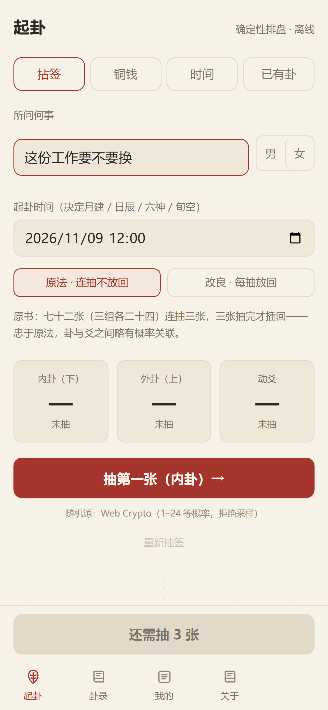
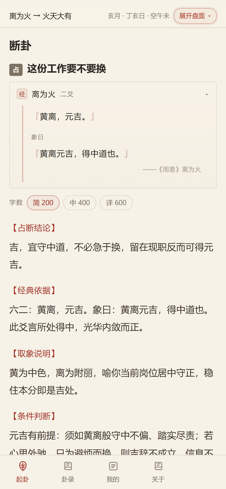

# 野鹤六爻

周易排盘与断卦，Android 版。**起卦与排盘全在本机离线完成**；需要解卦时，用你自己填的 API Key 直连大模型，不经过任何服务器。

- 下载：见 [Releases](https://github.com/woniu336/liuyao/releases)
- 网页版：<https://liuyao.dogcloud.workers.dev>

<p>
  
  
  
</p>

## 两种断法

| | 纳甲六爻 | 文辞义理 |
| --- | --- | --- |
| 依据 | 六亲、世应、月建日辰、旬空、动变 | 卦爻辞与象传（陆基《卜易新法玩占征验录》） |
| 起卦 | 四入口皆可 | 须一爻独发（拈签／时间／已有卦） |
| 输出 | 四段 400–550 字 | 五段，简 200／中 400／详 600 |

两套管线各自独立，事实包按断法过滤，不会混着用。

## 功能

**起卦**　拈签（七十二张，可切原法／改良）、铜钱、时间、已有卦。随机源为 Web Crypto，逐位取最低有效位、拒绝采样，不用伪随机。

**排盘**　纳甲装卦、安世应、定六亲、旬空、伏神、六神、神煞、月卦身。派生状态由引擎算定：
- 日冲四态：暗动／日破／冲空／冲
- 入墓分源：日辰墓／动爻墓（仅静爻）／本位变爻墓（仅动爻）
- 月建五行旺衰（旺、相、休、囚、受克）与日辰生克
- 进退神、化回头生克、化泄化耗、三合局、伏吟

**断卦**　顶栏吸顶迷你盘（六神／兆符／六亲／世应／○／变爻／标记）；文辞模式另有「经文卡」显示爻辞与象曰原文；可切字数档；结果自动存卦录。

**卦录**　记题干、性别、断法、四柱与盘面快照；展开可回看盘面与全文；支持搜索。

**存图**　排盘页右上「存图」，直接写入系统相册 `Pictures/zhouyi/`。

**提供商**　12 家可选：DeepSeek 官方、OpenCode、OpenAI、Moonshot、智谱、通义、硅基流动、魔搭、阶跃、Gemini、Ollama、自定义兼容接口。每家 Key 独立保存。

## 引擎

`packages/engine`（TypeScript，无框架依赖）：

- 四入口起卦 → 纳甲装卦 → 事实包 `zq-facts-1`
- 《卜易指南》**44 例盘面对拍零差异**（卦名／宫位／旬空／变卦／六神／六亲／纳甲／世应／动爻／变爻）
- 79 案经文**70 条锚点**校验（爻辞、小象与书中引文逐字一致，仅三处异体字）
- 202 项测试

## 仓库结构

```
apps/mobile      Capacitor Android 壳 + React UI
packages/engine  排盘引擎、事实包、经文与象传、应期候选
docs/            部署文档、断卦规范、设计记录
app/ lib/        Web 版（Next.js + Cloudflare Workers）
```

## 网页版部署

见 [docs/deploy.md](docs/deploy.md)；断卦规范原文见 [docs/prompt-liuyao.md](docs/prompt-liuyao.md)。

## 声明

术数为传统民俗文化研习，所作判断不作医疗、法律、投资依据；涉疾病、涉诉、涉险，先问专业人士。
